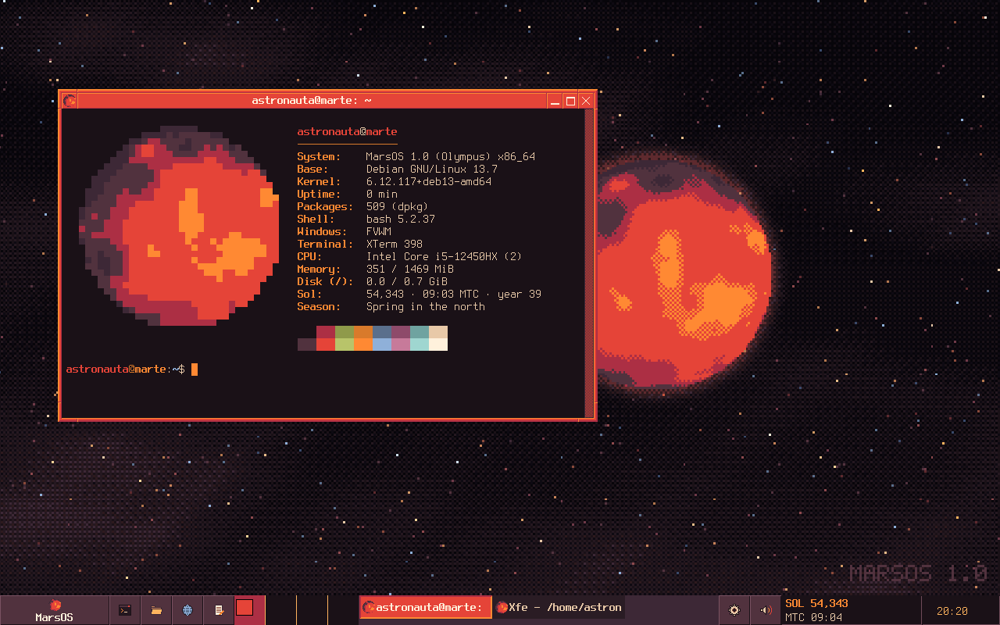
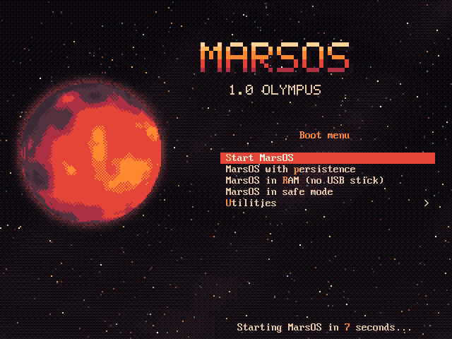
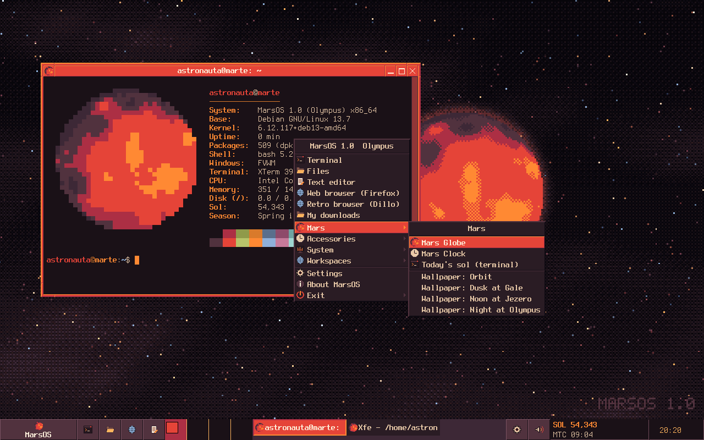
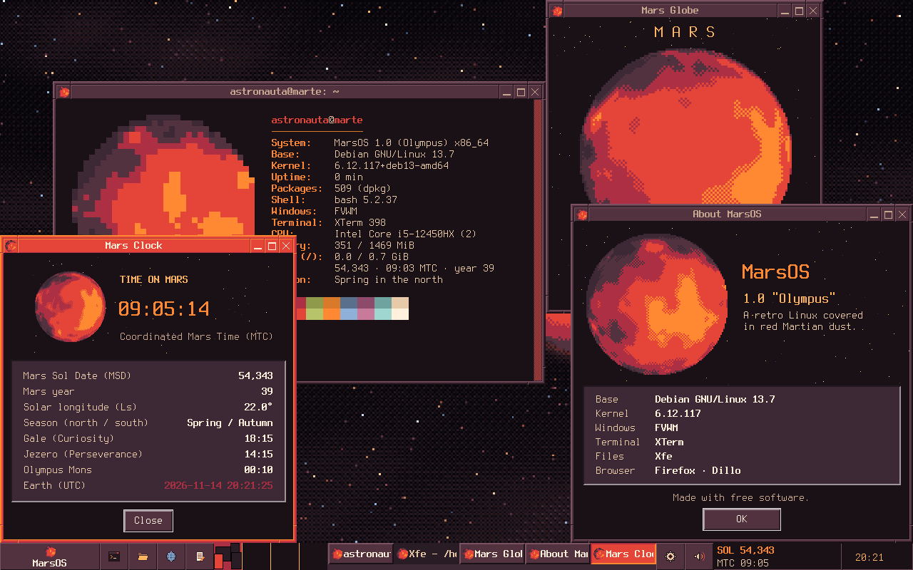
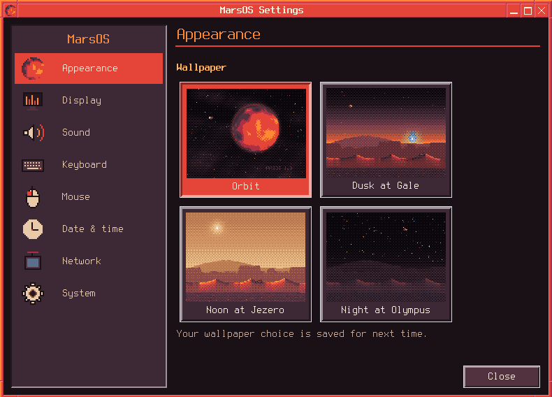

<div align="center">


# MarsOS 1.0 "Olympus"

**A retro Linux covered in red Martian dust.**

🇧🇷 [Português](README.md) · 🇺🇸 English

[](https://github.com/PeterMTPS/MarsOS/releases/latest/download/marsos-1.0-en-amd64.hybrid.iso)
[](https://petermtps.github.io/MarsOS/en/)




</div>

---

MarsOS is a live distribution based on **Debian GNU/Linux 13** with the look of 90s Linux:
text-mode boot, **FVWM** windows, bitmap fonts, Athena and Tk apps. Everything is painted
with the five colours of the planet in the logo:


It comes in two languages: **English** (`marsos-1.0-en-amd64.hybrid.iso`) and
**Portuguese** (`marsos-1.0-amd64.hybrid.iso`).

## Screens

| Boot menu | MarsOS menu |
|---|---|
|  |  |
| **Mars Clock, Globe and About** | **Settings** |
|  |  |

## What's inside

| | |
|---|---|
| 🚀 **Boot** | Boot menu with the planet (BIOS and UEFI), kernel messages in text mode and a 16-colour Martian console palette |
| 🪟 **Windows** | FVWM 2.7 with the **MarsBar** panel (menu, launchers, pager, tasks, Mars clock and volume) and 4 workspaces: Olympus, Valles, Gale and Jezero |
| 🕰️ **Time on Mars** | `sol`, `marsclock` and the panel clock: Mars Sol Date, MTC, season and local time at Gale and Jezero (NASA GISS Mars24 algorithm) |
| 🔊 **Sound** | PipeWire, panel volume (scroll to adjust), volume keys, `alsamixer` and a chiptune startup sound |
| ⚙️ **Settings** | `marsos-config`: wallpaper, resolution, sound, keyboard, mouse, time zone, network and system; applied at every start |
| 🌐 **Internet** | Firefox ESR and Dillo as a retro browser; downloads go to `~/Downloads` |
| 💾 **Persistence** | "MarsOS with persistence" boot option: files and programs survive a reboot |
| 🖥️ **Apps** | XTerm, Xfe, Xfw, Midnight Commander, htop, vim, xcalc, xclock, xeyes, `marsfetch`, `marsos-globo` |

## Download and use

1. Download the ISO from the [releases page](https://github.com/PeterMTPS/MarsOS/releases/latest).
2. Write it to a USB stick with [Rufus](https://rufus.ie) (DD mode) or [balenaEtcher](https://etcher.balena.io), or use a virtual machine (VirtualBox: Debian 64-bit, 2 GB RAM, VMSVGA, HDA audio).
3. Boot it and choose **Start MarsOS**. You are logged in automatically as `astronauta` (password `live`).

**Requirements:** 64-bit PC, 1.5 GB of RAM (2 GB recommended). Nothing is installed on your disk.

### Shortcuts

| Key | Action |
|---|---|
| Click the desktop or `Alt+F1` | MarsOS menu |
| `Alt+Tab` / `Alt+F4` | Switch / close window |
| `Ctrl+Alt+T` | Terminal |
| `Ctrl+Alt+←` / `→` | Switch workspace |
| `Alt` + drag | Move window |

## Building the ISO

### On a Debian 13 machine

```bash
sudo apt install live-build
sudo ./build.sh en     # English ISO
sudo ./build.sh        # Portuguese ISO
```

### On Windows (with VirtualBox)

```powershell
# 1. Builder VM (minimal Debian 13, installs itself). Only once:
powershell -ExecutionPolicy Bypass -File tools\construtora\criar-vm-construtora.ps1
# 2. Build the ISO inside the VM and bring it to saida\
powershell -ExecutionPolicy Bypass -File tools\construir.ps1 -Idioma en
# 3. Test it in a VM (add -Uefi to test UEFI)
powershell -ExecutionPolicy Bypass -File tools\testar.ps1 -Iso saida\marsos-1.0-en-amd64.hybrid.iso
```

### How the languages work

The project is written in Portuguese. The `idiomas/en/` folder mirrors the project paths
and holds only the files that change in English (menus, boot, messages, locale and keyboard).
`build.sh en` assembles a copy in `build-en/` with that layer on top. The Martian apps are
bilingual (`usr/lib/marsos/marsi18n.py`) and follow the system language.

---

<div align="center">
<br>
Made by <a href="https://github.com/PeterMTPS">Pedro</a> · based on Debian GNU/Linux
</div>
