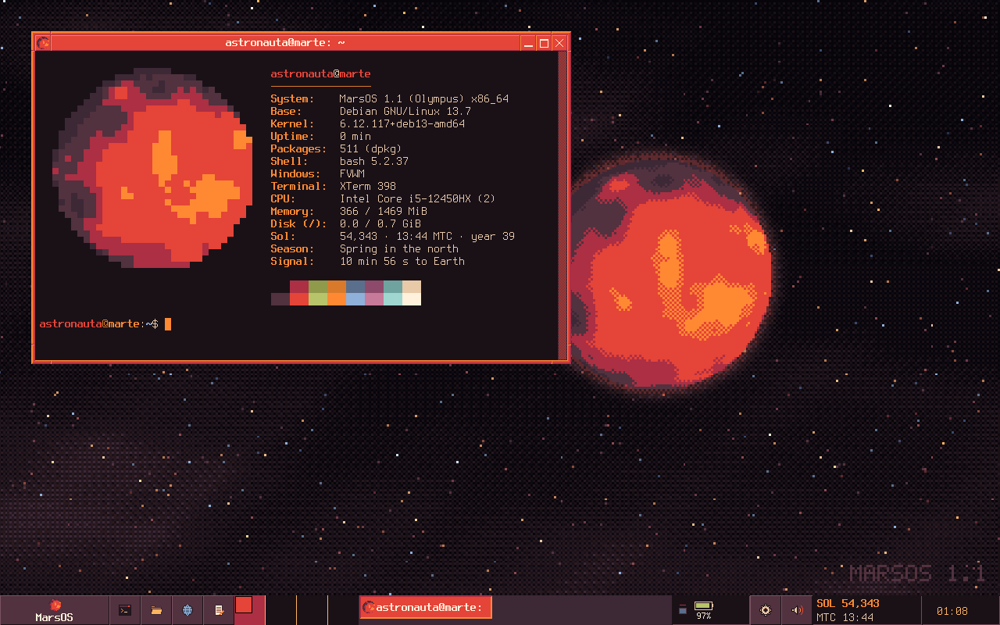
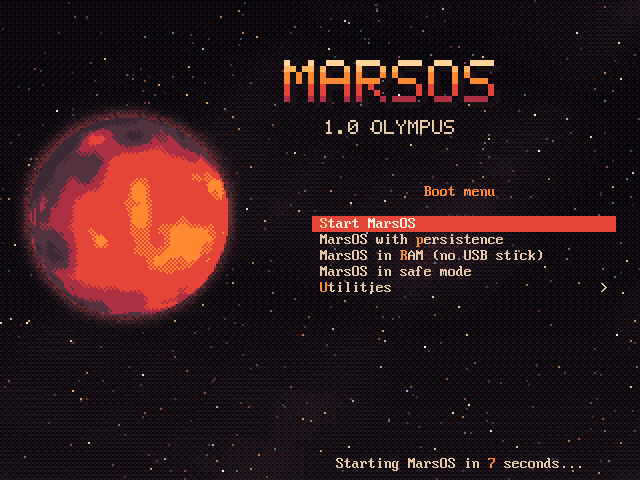
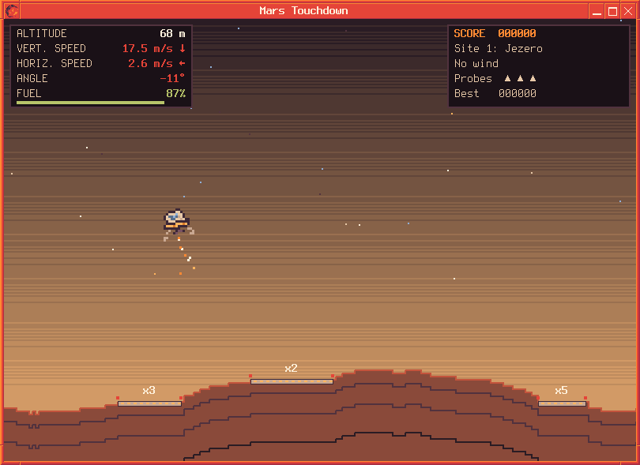
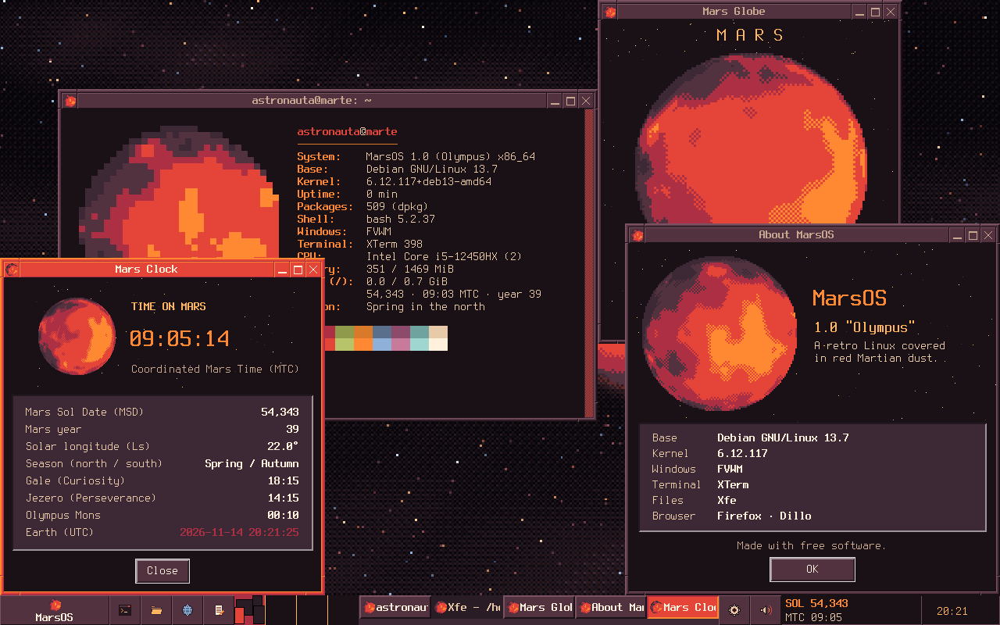
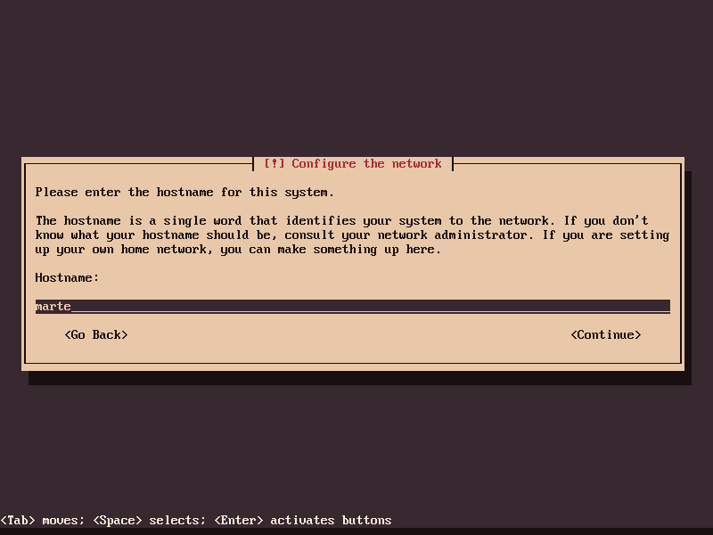

<div align="center">


# MarsOS 1.1 "Olympus"

**A retro Linux covered in red Martian dust.**

🇺🇸 English · 🇧🇷 [Português](README.pt-BR.md)

[](https://github.com/PeterMTPS/MarsOS/releases/latest/download/marsos-1.1-amd64.hybrid.iso)
[](https://petermtps.github.io/MarsOS/)


[](LICENSE)
[](https://github.com/PeterMTPS/MarsOS/actions/workflows/build-iso.yml)



</div>

---

MarsOS is a distribution based on **Debian GNU/Linux 13** with the look of 90s Linux:
text-mode boot, **FVWM** windows, bitmap fonts, Athena and Tk apps. Everything is painted
with the five colours of the planet in the logo:


One ISO speaks two languages: pick **English** or **Português** in the boot menu. Run it live
from a USB stick, or install it to the disk.

## Screens

| Boot menu | Mars Touchdown (game) |
|---|---|
|  |  |
| **Mars Clock, Globe and About** | **Installer** |
|  |  |

## What's inside

| | |
|---|---|
| 🚀 **Boot** | Boot menu with the planet (BIOS and UEFI) and the language choice, kernel messages in text mode and a 16-colour Martian console palette |
| 💽 **Installer** | Text-mode installer in Martian colours (*Install MarsOS* in the boot menu): copies the system to the disk, with your own user |
| 🪟 **Windows** | FVWM 2.7 with the **MarsBar** panel (menu, launchers, pager, tasks, network and battery, Mars clock and volume) and 4 workspaces: Olympus, Valles, Gale and Jezero |
| 🕰️ **Time on Mars** | `sol`, `marsclock` and the panel clock: Mars Sol Date, MTC, season and local time at Gale and Jezero (NASA GISS Mars24 algorithm) |
| 📡 **Signal delay** | Distance to Earth and how long a radio message takes (3 to 22 minutes), from JPL orbital elements, with a warning during solar conjunction |
| 📡 **Mission Control** | The active missions (Perseverance and Curiosity) with their current sol, local time and day/night, and **Mail to Mars**: send a message to a rover, it arrives after the real signal delay and the rover's reply comes back just as long later (also from the terminal: `correio-marte "hello, Mars!"`) |
| 🎮 **Mars Touchdown** | An original lander game: land a probe at Jezero, Gale, Elysium, Valles Marineris and Olympus Mons, against Mars gravity, low fuel and dust-storm winds |
| 🔊 **Sound** | PipeWire, panel volume (scroll to adjust), volume keys, a chiptune startup sound and event sounds (windows, workspaces, screenshots, shutdown). Optional **Real Mars** sound theme made from recordings NASA's Perseverance made on Mars: wind, a dust devil, its laser and the Ingenuity helicopter |
| 📸 **Screenshots** | `Print Screen` (whole screen), `Alt+Print` (window), `Shift+Print` (pick an area), saved to `~/Pictures` |
| 🔋 **Network and battery** | Panel indicator for cable / Wi-Fi signal / offline and battery, with alerts when the network drops or the battery runs low |
| ⚙️ **Settings** | `marsos-config`: wallpaper, resolution, sound, keyboard, mouse, time zone, network, language and system |
| 🌐 **Internet** | Firefox ESR and Dillo as a retro browser; downloads go to `~/Downloads` |
| 💾 **Persistence** | "Persistence" boot option: files and programs survive a reboot without installing |
| 🖥️ **Apps** | AbiWord (documents, opens .doc/.docx/.odt), Gnumeric (spreadsheets), mpv (video and music), mtPaint (pixel art), xarchiver (zip, 7z, rar), GParted, newsboat (RSS), irssi (IRC), cmus (music), XTerm, Xfe, Midnight Commander, htop, vim, `marsfetch`, `marsos-globo` — all in the Martian colours. PDFs open in Firefox |

## Download and use

1. Download the ISO from the [releases page](https://github.com/PeterMTPS/MarsOS/releases/latest).
2. Write it to a USB stick with [Rufus](https://rufus.ie) (DD mode) or [balenaEtcher](https://etcher.balena.io), or use a virtual machine (VirtualBox: Debian 64-bit, 2 GB RAM, VMSVGA, HDA audio).
3. Boot it and choose **Start MarsOS - English** or **Iniciar o MarsOS - Português**. You are logged in automatically as `astronauta` (password `live`).
4. To keep MarsOS, choose **Install MarsOS** in the boot menu instead.

**Requirements:** 64-bit PC, 1.5 GB of RAM (2 GB recommended), and 8 GB of disk to install.

### Shortcuts

| Key | Action |
|---|---|
| Click the desktop or `Alt+F1` | MarsOS menu |
| `Alt+Tab` / `Alt+F4` | Switch / close window |
| `Ctrl+Alt+T` | Terminal |
| `Ctrl+Alt+←` / `→` | Switch workspace |
| `Print` / `Alt+Print` / `Shift+Print` | Screenshot: screen / window / area |
| `Alt` + drag | Move window |

## Building the ISO

### On GitHub (automatic)

The [Build ISO](.github/workflows/build-iso.yml) workflow builds the ISO in a Debian 13 container.
Pushing a tag such as `v1.1` builds it and publishes it in that release; the **Run workflow**
button on the Actions tab builds it and keeps it as a download for 7 days.

### On a Debian 13 machine

```bash
sudo apt install live-build
sudo ./build.sh
```

### On Windows (with VirtualBox)

```powershell
# 1. Builder VM (minimal Debian 13, installs itself). Only once:
powershell -ExecutionPolicy Bypass -File tools\construtora\criar-vm-construtora.ps1
# 2. Build the ISO inside the VM and bring it to saida\
powershell -ExecutionPolicy Bypass -File tools\construir.ps1
# 3. Test it in a VM (add -Uefi to test UEFI)
powershell -ExecutionPolicy Bypass -File tools\testar.ps1
```

### How the languages work

The boot menu entries set the locale, keyboard and time zone (`locales=`, `keyboard-layouts=`,
`timezone=`). The Martian apps are bilingual (`usr/lib/marsos/marsi18n.py`) and follow `LANG`;
the FVWM menus live in `~/.fvwm/textos.en` and `textos.pt`, and `~/.xinitrc` picks one.
Settings → System can switch the language of the session later.

## License

MarsOS's own code, menus, artwork and sounds are free software under the
[GNU General Public License 3.0](LICENSE) (or any later version). The packages that come
from Debian keep their own licenses.
The optional "Real Mars" sounds (`usr/share/marsos/sons/marte`) are excerpts of NASA recordings
(NASA/JPL-Caltech/LANL/CNES/CNRS/ISAE-Supaero) used under NASA's media guidelines, not the GPL.

---

<div align="center">
<br>
Made by <a href="https://github.com/PeterMTPS">Pedro</a> · based on Debian GNU/Linux · GPL 3.0
</div>
