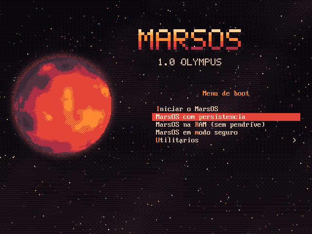
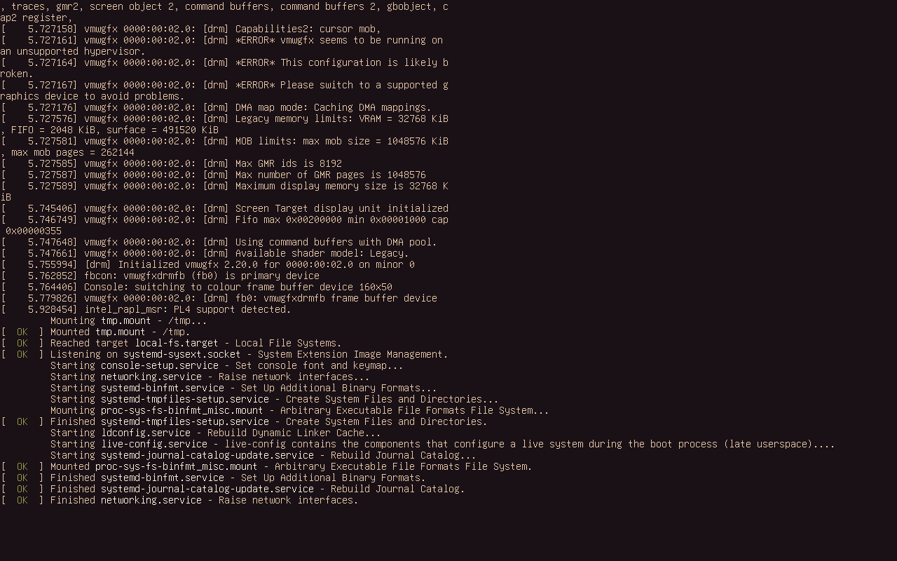
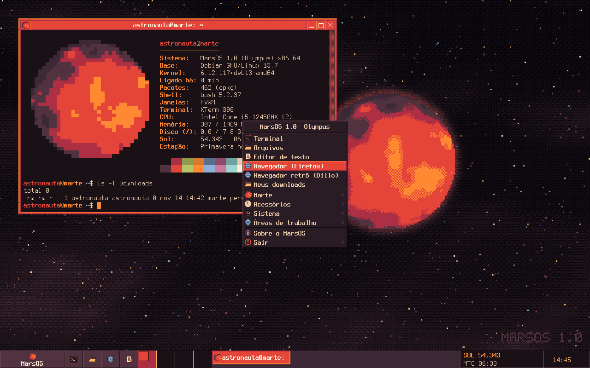
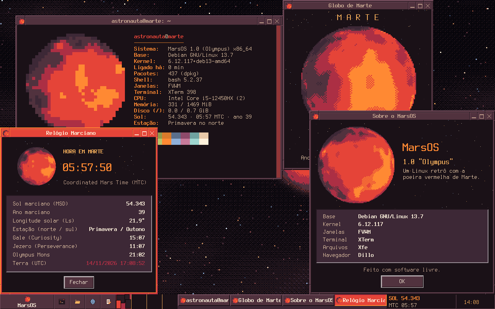
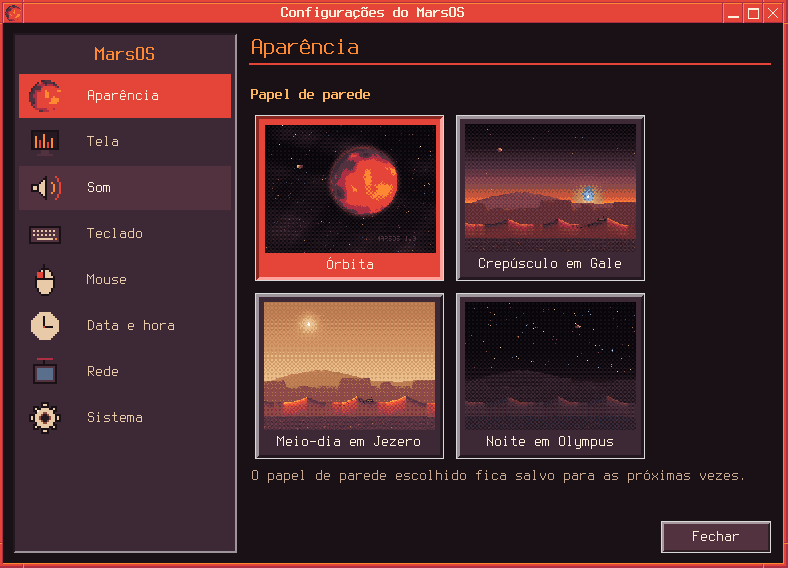
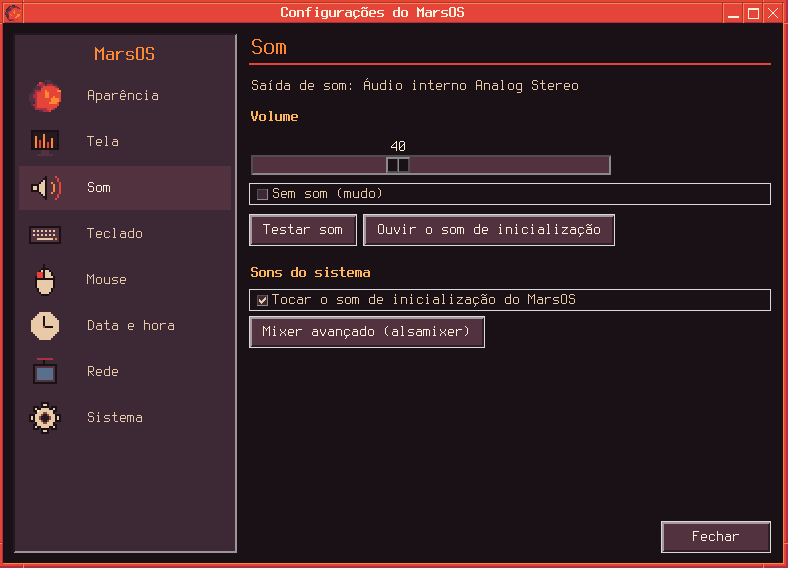

<div align="center">


# MarsOS 1.0 "Olympus"

**Um Linux retrô com a poeira vermelha de Marte.**

[](https://github.com/PeterMTPS/MarsOS/releases/latest/download/marsos-1.0-amd64.hybrid.iso)
[](https://PeterMTPS.github.io/MarsOS/)


</div>

---

O MarsOS é uma distribuição live baseada no **Debian GNU/Linux 13** com a cara dos Linux dos
anos 90: boot em texto, janelas **FVWM**, fontes bitmap, apps Athena e Tk. Tudo pintado com
as cinco cores do planeta do logo:


## Telas

| Menu de boot | Boot em texto |
|---|---|
|  |  |
| **Menu do MarsOS** | **Relógio marciano, globo e Sobre** |
|  |  |
| **Configurações: aparência** | **Configurações: som** |
|  |  |

## O que vem no sistema

| | |
|---|---|
| 🚀 **Boot** | Menu com o planeta (BIOS e UEFI), mensagens do kernel em texto e console com paleta marciana de 16 cores |
| 🪟 **Janelas** | FVWM 2.7 com painel **MarsBar** (menu, atalhos, pager, tarefas, relógio marciano e volume) e 4 áreas de trabalho: Olympus, Valles, Gale e Jezero |
| 🕰️ **Hora em Marte** | `sol`, `marsclock` e o relógio do painel: sol marciano, MTC, estação e hora local em Gale e Jezero (algoritmo Mars24 da NASA GISS) |
| 🔊 **Som** | PipeWire, volume no painel (a rodinha do mouse ajusta), teclas de volume, `alsamixer` e som de inicialização chiptune |
| ⚙️ **Configurações** | `marsos-config`: papel de parede, resolução, som, teclado, mouse, fuso horário, rede e sistema; aplicadas a cada início |
| 🌐 **Internet** | Firefox ESR em português e o Dillo como navegador retrô; downloads em `~/Downloads` |
| 💾 **Persistência** | Opção "MarsOS com persistência" no boot: arquivos e programas sobrevivem ao reinício |
| 🖥️ **Apps** | XTerm, Xfe, Xfw, Midnight Commander, htop, vim, xcalc, xclock, xeyes, `marsfetch`, `marsos-globo` |

## Baixar e usar

1. Baixe a ISO na [página de releases](https://github.com/PeterMTPS/MarsOS/releases/latest) (641 MB).
2. Grave num pendrive com o [Rufus](https://rufus.ie) (modo DD) ou o [balenaEtcher](https://etcher.balena.io), ou use uma máquina virtual (VirtualBox: Debian 64-bit, 2 GB de RAM, VMSVGA, áudio HDA).
3. Dê boot e escolha **Iniciar o MarsOS**. O login é automático como `astronauta` (senha `live`).

**Requisitos:** PC 64 bits, 1,5 GB de RAM (2 GB recomendado). Nada é instalado no disco.

### Atalhos

| Tecla | Ação |
|---|---|
| Clique no fundo ou `Alt+F1` | Menu do MarsOS |
| `Alt+Tab` / `Alt+F4` | Trocar / fechar janela |
| `Ctrl+Alt+T` | Terminal |
| `Ctrl+Alt+←` / `→` | Trocar de área de trabalho |
| `Alt` + arrastar | Mover janela |

## Gerar a ISO

### Numa máquina Debian 13

```bash
sudo apt install live-build
sudo ./build.sh
```

### No Windows (com VirtualBox)

```powershell
# 1. VM construtora (Debian 13 mínimo, instalado sozinho). Só uma vez:
powershell -ExecutionPolicy Bypass -File tools\construtora\criar-vm-construtora.ps1
# 2. Gera a ISO dentro da VM e traz para saida\
powershell -ExecutionPolicy Bypass -File tools\construir.ps1
# 3. Testa numa VM (use -Uefi para testar UEFI)
powershell -ExecutionPolicy Bypass -File tools\testar.ps1
# 4. (Opcional) disco de persistência para a VM de teste
powershell -ExecutionPolicy Bypass -File tools\criar-disco-persistente.ps1
```

### Persistência num pendrive

Depois de gravar a ISO, crie no espaço livre do pendrive uma partição ext4 com o rótulo
`persistence` e coloque nela um arquivo `persistence.conf` com o conteúdo `/ union`.
Inicie com **MarsOS com persistência**.

## Estrutura do projeto

```
auto/config                  opções do live-build (Debian 13, idioma, paleta do console)
build.sh                     gera a ISO
config/package-lists/        pacotes do sistema
config/hooks/live/           ajustes finais dentro do sistema
config/includes.chroot/      arquivos copiados para o sistema
  etc/skel/                  FVWM, XTerm, bash e Xfe do usuário
  usr/local/bin/             apps marcianos (sol, marsfetch, marsclock, marsos-config...)
  usr/lib/marsos/            marstime, marssom, marsconf e marstk
  usr/share/marsos/          papéis de parede, ícones, sons, logo e quadros da animação
assets/logo/                 o logo (PNG, GIF girando e sprites)
assets/gerar_arte.py         gera papéis de parede, splash, ícones e o /etc/issue a partir do logo
assets/gerar_som.py          sintetiza os sons do sistema
assets/boot/                 menus de boot (isolinux e GRUB)
docs/                        site de download (GitHub Pages)
tools/                       scripts do Windows (VM construtora, build, teste)
```

---

<div align="center">
<br>
Feito por <a href="https://github.com/PeterMTPS">Pedro</a> · baseado no Debian GNU/Linux
</div>
